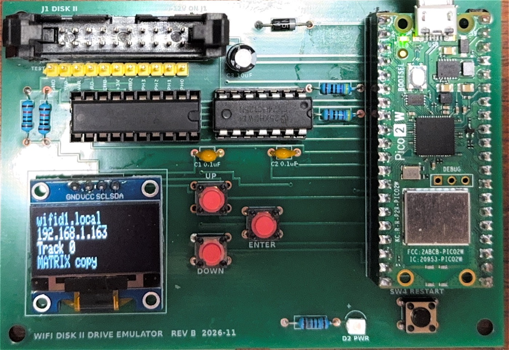

# Board rev B (schematic r0.3)

Ordered 2026-11-14, built and tested on the //e 2026-11-19. Superseded by
rev C (`../REVC/`) but fully supported: both boards run the same firmware.

- `wifi-disk-ii-schematic-r0.3.svg`, `schematic.jpg`: schematic
- `fab/wifi-disk-ii-revB-gerbers.zip`: the exact zip ordered from JLCPCB
- `fit-check-revB-1to1.pdf`: 1:1 print for checking real parts
- `wifi-disk-ii-revB-top.png`, `-bottom.png`: renders parsed from the Gerbers
- `source/`: Python generators (see `source/README.txt`)

## Optional: D2 as the activity LED

As built, D2 (marked PWR) is a power LED: R5 runs from +3V3. One cut and
one wire on the back turn it into the activity LED (lit while the Apple
uses the drive or a write is being saved; off = safe to power off). The
firmware drives Pico pin 21 (GP16) for this on every board, so nothing
changes in software. Rev C has this change built in.

1. Fit D2 and R5 (blue LED with R5 = 180 Ω; red, yellow or green: about
   330 to 470 Ω).
2. On the bottom layer, cut the trace leaving R5's +3V3 pad (the R5 pad
   farther from D2) on its first short run, about 2.5 mm toward the J1
   edge, next to the pad. That pad feeds only R5.
3. Meter: R5's +3V3 pad to Pico pin 36 (3V3) now reads open.
4. Wire that R5 pad to Pico pin 21 (GP16), which has no other connection
   on the board.

Same procedure, for users: `DOCS/user-guide.md`, section 6.
