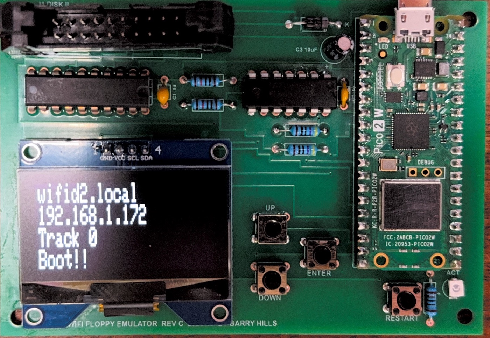
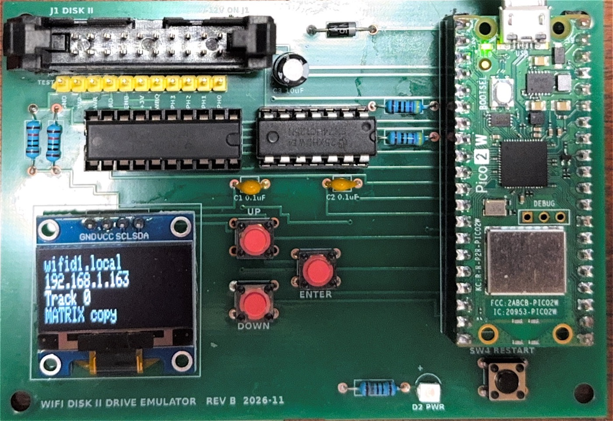

# Apple II WiFi Floppy Emulator

A Raspberry Pi Pico 2 W board that plugs into an Apple Disk II controller
card's drive connector and acts as a 5.25" drive (drive 1 or 2). Disk images
(`.dsk`, `.woz`) are loaded over WiFi from a web page or with `curl`; the
Apple side runs stock DOS 3.3, unmodified, and reads and writes them like
floppies.

| Rev C (current) | Rev B |
|---|---|
|  |  |
| 1.54" OLED, activity LED built in | 0.96" OLED, D2 is a power LED (activity LED optional, see below) |

## One firmware, either board

There is **one firmware image** and it runs on both boards unchanged: rev B
and rev C are electrically the same circuit (same Pico pins, same buffer
chips) apart from the activity LED. Either OLED module works on either board
(0.96" SSD1306 or 1.54" SH1106-class / CH1116; same 4-pin header). Images and
WiFi settings live on the Pico, so a Pico can move between boards.

| | Rev B | Rev C |
|---|---|---|
| Activity LED (D2) | power LED as built; **optional** one cut + one wire makes it the activity LED ([user guide, section 6](DOCS/user-guide.md#6-optional-activity-led-rev-b-board)) | activity LED as built (R5 from Pico pin 21 / GP16, 180 Ω) |
| Test header | J2, 11 pins for a logic analyzer | none |
| Firmware | `a2drive.uf2` | the same `a2drive.uf2` |

On an unmodified rev B the firmware still drives Pico pin 21; nothing is
connected to it there, so no harm is done.

## Files

**Turn the Apple off before connecting or disconnecting the ribbon**, and
read section 1 of the user guide before the first connection.

- **Using it:** [DOCS/user-guide.md](DOCS/user-guide.md): firmware loading,
  WiFi setup, the web page and buttons, the lights, the optional rev B
  activity LED change.
- **Hardware:** one folder per board revision: `HW/REVC/` (current:
  schematic r0.4, Gerber zip in `fab/`, 1:1 fit check, renders, generator
  source; notes in `NOTES.md`) and `HW/REVB/` (schematic r0.3, Gerbers, fit
  check, generator source).
- **Firmware:** download the ready-made Pico image,
  [a2drive.uf2](https://github.com/barryhills/apple-ii-wifi-floppy-emulator/releases/latest/download/a2drive.uf2)
  (latest release; how to load it: [user guide](DOCS/user-guide.md), section 2).
  Source: C, Raspberry Pi Pico SDK (`SW/firmware/`). Build:
  `cmake -S SW/firmware -B SW/firmware/build -G Ninja && ninja -C SW/firmware/build`.
- **Design record:** `DESIGN.md`: decisions, sources, test history.
- **Licence:** MIT (`LICENSE`); borrowed code and its licences:
  `THIRD-PARTY-NOTICES.md`.
